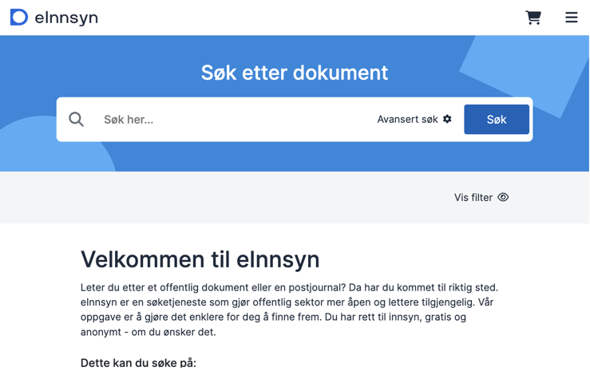
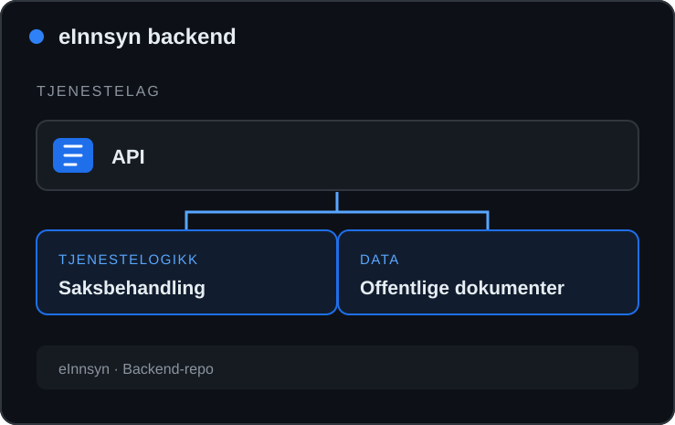
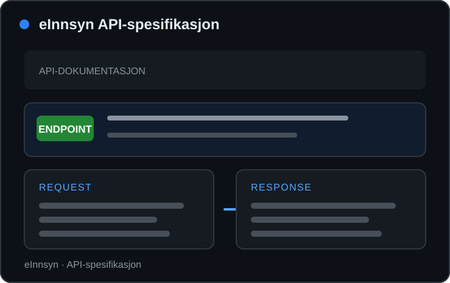
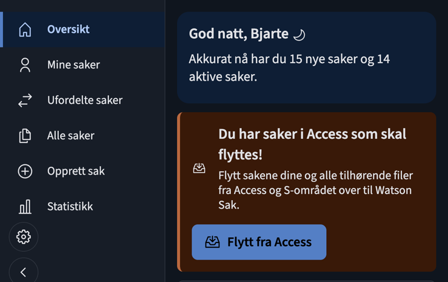
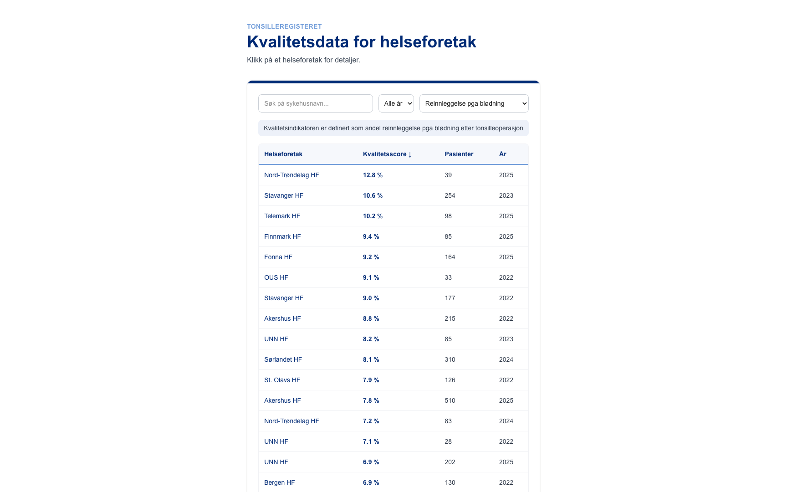

  FULLSTACK-UTVIKLER · OSLO

<h1 align="center">Hei, jeg er Khalid 👋</h1>

  Jeg liker å lage løsninger som fungerer. Har du et spennende prosjekt? Jeg er åpen for samarbeid.

  <a href="https://no.linkedin.com/in/khalid-hashi-18b97119a">LinkedIn</a>&nbsp;·&nbsp;
  <a href="https://github.com/Khhashi">GitHub-prosjekter</a>&nbsp;·&nbsp;
  <a href="mailto:khalidkhalif1507@gmail.com">E-post</a>

## 01 / Åpen kildekode

Offentlig teknologi skal åpne dører, ikke lage flere køer. Jeg skriver kode for mer innsyn og enklere saksbehandling.

<table>
  <tr>
    <td width="50%" valign="top">
      
      
OFFENTLIG INNSYN · FRONTEND

      <h3><a href="https://github.com/felleslosninger/einnsyn-frontend">eInnsyn frontend</a></h3>
      
Brukergrensesnitt for søk og innsyn i offentlige dokumenter. 12 forslag, hvorav 2 er merget.

      
<a href="https://github.com/felleslosninger/einnsyn-frontend">⌘ Se repo</a>

    </td>
    <td width="50%" valign="top">
      
      
OFFENTLIG INNSYN · BACKEND

      <h3><a href="https://github.com/felleslosninger/einnsyn-backend">eInnsyn backend</a></h3>
      
Backend for eInnsyn. Jeg har sendt 5 forslag til API og saksbehandlingslogikk.

      
<a href="https://github.com/felleslosninger/einnsyn-backend">⌘ Se repo</a>

    </td>
  </tr>
  <tr>
    <td width="50%" valign="top">
      
      
OFFENTLIG INNSYN · API

      <h3><a href="https://github.com/felleslosninger/einnsyn-api-spec">eInnsyn API-spesifikasjon</a></h3>
      
API-beskrivelsen for eInnsyn. Jeg har sendt 2 forslag til spesifikasjonen.

      
<a href="https://github.com/felleslosninger/einnsyn-api-spec">⌘ Se repo</a>

    </td>
    <td width="50%" valign="top">
      
      
SAKSBEHANDLING · NAV

      <h3><a href="https://github.com/Khhashi/watson-sak-frontend">Watson Sak frontend</a></h3>
      
Frontend for saksbehandling, bygget med React Router og Navs Aksel-designsystem.

      
<a href="https://github.com/Khhashi/watson-sak-frontend">⌘ Se repo</a>

    </td>
  </tr>
</table>

## 02 / Egne prosjekter

<table>
  <tr>
    <td width="33%" valign="top">
      
      
NETTBUTIKK · BETALING

      <h3><a href="https://github.com/Khhashi/Nordly">🛍️ Nordly</a></h3>
      
Nettbutikk med trygg betaling gjennom Stripe Checkout.

      
<a href="https://ordermanager-8ym2.onrender.com/">↗ Demo</a> · <a href="https://github.com/Khhashi/Nordly">⌘ Kode</a> · <a href="https://github.com/users/Khhashi/projects/4">Prosjekttavle</a>

      C# · .NET 8 · PostgreSQL · Stripe · Docker
    </td>
    <td width="33%" valign="top">
      
      
ARRANGEMENTER · SANNTID

      <h3><a href="https://github.com/Khhashi/eventhub">📅 Møteplass</a></h3>
      
Finn lokale arrangementer, inviter andre og meld deg på.

      
<a href="https://eventmeeting-f3eu.onrender.com/events">↗ Demo</a> · <a href="https://github.com/Khhashi/eventhub">⌘ Kode</a> · <a href="https://github.com/users/Khhashi/projects/9">Prosjekttavle</a>

      React · Node.js · MongoDB · Socket.IO
    </td>
    <td width="33%" valign="top">
      
      
ÅPNE DATA · HELSE

      <h3><a href="https://github.com/Khhashi/helse-kvalitet-dashboard">📊 Sykehusdata</a></h3>
      
Sammenlign helseforetak med åpne SKDE-data.

      
<a href="https://helse-kvalitet-dashboard.vercel.app">↗ Demo</a> · <a href="https://github.com/Khhashi/helse-kvalitet-dashboard">⌘ Kode</a> · <a href="https://github.com/users/Khhashi/projects/12">Prosjekttavle</a>

      Next.js · TypeScript · Tailwind CSS · Vitest
    </td>
  </tr>
</table>

## 03 / Verktøy

  
  
  
  
  
  
  
   
  
  
  
  
  
  

