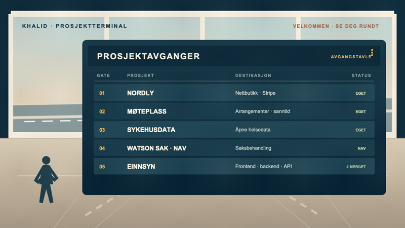

# Hei, jeg er Khalid

Jeg bygger egne prosjekter og bidrar til åpen kildekode.

Velkommen inn. Tavla viser noen av prosjektene mine og bidragene mine til åpen kildekode.

## Avgangstavle

| Gate | Destinasjon | Hva du finner der |
|:---:|---|---|
| 01 | [Nordly](#gate-01-nordly) | Nettbutikk · Stripe |
| 02 | [Møteplass](#gate-02-moteplass) | Arrangementer · sanntid |
| 03 | [Sykehusdata](#gate-03-sykehusdata) | Åpne helsedata |
| 04 | [Watson Sak · NAV](#gate-04-watson-sak-for-nav) | Saksbehandling |
| 05 | [eInnsyn](#gate-05-einnsyn) | Åpen kildekode · PR-status |

### Gate 01: Nordly

Jeg bygde en nettbutikk med Stripe Checkout. Ordren bekreftes først når betalingen er verifisert.

[Demo](https://ordermanager-8ym2.onrender.com/) · [Kode](https://github.com/Khhashi/Nordly) · [Tavle](https://github.com/users/Khhashi/projects/4)

`C#` `.NET 8` `PostgreSQL` `Stripe` `Docker`

### Gate 02: Møteplass

Jeg ville lage et sted der folk kan finne lokale arrangementer — eller lage et selv og invitere andre. Her er det Google-innlogging og sanntidsfunksjoner også.

[Demo](https://eventmeeting-f3eu.onrender.com/events) · [Kode](https://github.com/Khhashi/eventhub) · [Tavle](https://github.com/users/Khhashi/projects/9)

`React` `Node.js` `MongoDB` `Socket.IO`

### Gate 03: Sykehusdata

Jeg brukte åpne SKDE-data for å gjøre det lettere å sammenligne helseforetak og følge kvalitetsindikatorer.

[Dashboard](https://helse-kvalitet-dashboard.vercel.app) · [Kode](https://github.com/Khhashi/helse-kvalitet-dashboard) · [Tavle](https://github.com/users/Khhashi/projects/12)

`Next.js` `TypeScript` `Tailwind CSS` `Vitest`

### Gate 04: Watson Sak for NAV

Frontend for saksbehandling i Watson Sak hos NAV, bygget med React Router, React og Navs Aksel-designsystem.

[Kode](https://github.com/Khhashi/watson-sak-frontend)

`React` `React Router` `TypeScript` `Aksel`

### Gate 05: eInnsyn

Jeg har sendt inn 19 PR-er til frontend, backend og API-spesifikasjonen. To frontend-endringer er merget; resten er merket med status så det er lett å se hva som fortsatt er åpent eller ble lukket.

**Frontend**

- [#480 · Hindre tomt datofilter ved fokus](https://github.com/felleslosninger/einnsyn-frontend/pull/480) — Åpen
- [#478 · Fjerne API-nøkkel etter vellykket sletting](https://github.com/felleslosninger/einnsyn-frontend/pull/478) — Åpen
- [#475 · Synkronisere enum-filter med URL](https://github.com/felleslosninger/einnsyn-frontend/pull/475) — Åpen
- [#473 · Oversette etiketter for egendefinert datoperiode](https://github.com/felleslosninger/einnsyn-frontend/pull/473) — Åpen
- [#440 · Legge møter til i kalender fra søkeresultater](https://github.com/felleslosninger/einnsyn-frontend/pull/440) — Åpen
- [#435 · Åpne dokumenter fra journalpostresultater](https://github.com/felleslosninger/einnsyn-frontend/pull/435) — Åpen
- [#434 · Beholde filterverdier med mellomrom](https://github.com/felleslosninger/einnsyn-frontend/pull/434) — **Merget**
- [#424 · Fortsette søket når et filter er ukjent](https://github.com/felleslosninger/einnsyn-frontend/pull/424) — Åpen
- [#421 · Holde mislykkede søk adskilt](https://github.com/felleslosninger/einnsyn-frontend/pull/421) — Åpen
- [#417 · Hindre utrygge videresendinger etter innlogging](https://github.com/felleslosninger/einnsyn-frontend/pull/417) — **Merget**

**Backend**

- [#796 · Beholde enhetsfilter ved konvertering av lagrede søk](https://github.com/felleslosninger/einnsyn-backend/pull/796) — Åpen
- [#784 · Teste innholdet i e-poster om tilgangsforespørsler](https://github.com/felleslosninger/einnsyn-backend/pull/784) — Åpen

**API-spesifikasjon**

- [#71 · Legge til kladdfelt for tilgangsforespørsler](https://github.com/felleslosninger/einnsyn-api-spec/pull/71) — Lukket, ikke merget
- [#72 · Legge til send-endepunkt for kladder](https://github.com/felleslosninger/einnsyn-api-spec/pull/72) — Lukket, ikke merget

Flere forslag som ble lukket uten merge

**Frontend**

- [#467 · Beholde filterverdier med mellomrom](https://github.com/felleslosninger/einnsyn-frontend/pull/467)
- [#431 · Vise riktig header på oversatte sider](https://github.com/felleslosninger/einnsyn-frontend/pull/431)

**Backend**

- [#794 · Kontrollere lenkesjekk når kilde-URL endres](https://github.com/felleslosninger/einnsyn-backend/pull/794)
- [#788 · Sende kladder for tilgangsforespørsler](https://github.com/felleslosninger/einnsyn-backend/pull/788)
- [#787 · Lagre kladder for tilgangsforespørsler](https://github.com/felleslosninger/einnsyn-backend/pull/787)

[Se eInnsyn-koden](https://github.com/felleslosninger/einnsyn-frontend)

## I håndbagasjen

- **Frontend:** React, Next.js, TypeScript, JavaScript, Tailwind CSS, Vite
- **Backend og data:** Node.js, Express, C#, .NET, PostgreSQL, MongoDB
- **Testing og drift:** Vitest, Docker, GitHub Actions

---

Neste avgang? [Send meg en e-post](mailto:khalidkhalif1507@gmail.com) eller finn meg på [LinkedIn](https://no.linkedin.com/in/khalid-hashi-18b97119a).
